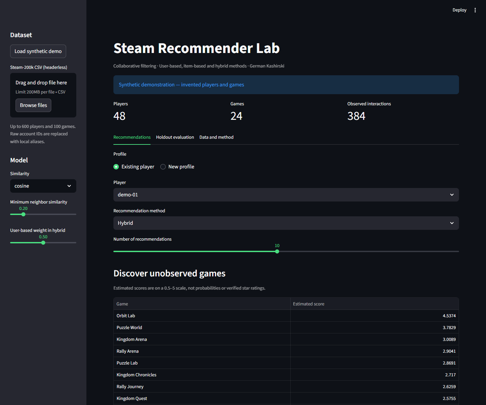
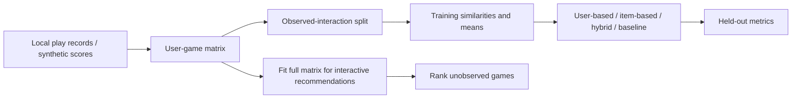

# Steam Recommender Lab

[](https://github.com/Germanskii/steam-recommender/actions/workflows/checks.yml)

A small, explainable collaborative-filtering project based on German Kashirski’s
RTU MIREA coursework. Compare **user-based**, **item-based** and **hybrid** recommendations
against an **item-mean baseline**, using a reproducible observed-interaction holdout.

**Python · NumPy · pandas · Streamlit · pytest**



## Features

- Runs offline with invented players and games; no API key or Steam login.
- Imports a locally supplied Steam-200k CSV without publishing account IDs.
- Cosine, Jaccard, overlap-only Pearson and mixed cosine/Pearson similarity.
- Existing-player recommendations and a manually entered new profile.
- Excludes games already observed in the selected profile.
- Reports RMSE, MAE, Recall@5 and NDCG@5 on the same seeded split for all methods.
- English dashboard, CSV/JSON exports, CLI, notebook walkthrough and automated checks.

This is an educational dense-matrix implementation, not a production Steam service.
Playtime-derived scores are **implicit engagement proxies**, not user star ratings or
probabilities of enjoying a game. Synthetic results demonstrate behavior, not market quality.

## Quick start

Python **3.10–3.12**. Start from a terminal:

```bash
git clone https://github.com/Germanskii/steam-recommender.git
cd steam-recommender
python -m venv .venv
```

Windows PowerShell:

```powershell
.\.venv\Scripts\Activate.ps1
```

macOS/Linux:

```bash
source .venv/bin/activate
```

Then:

```bash
python -m pip install -r requirements.txt
python -m streamlit run app.py
```

Open the local URL printed by Streamlit. Synthetic recommendations appear immediately.
If PowerShell activation is blocked, use `.\.venv\Scripts\python.exe` instead of `python`.

1. Select a player, similarity and recommendation method.
2. Adjust the neighbor threshold or hybrid weight.
3. Open **Holdout evaluation** and click **Run holdout evaluation**.
4. Compare all four methods, then download metrics and settings.
5. Use **New profile** to enter a few illustrative preferences and see unseen-game rankings.

Manual preference scores are not calibrated to the playtime transform. With no history,
mean-score fallbacks apply. Changing data or model settings hides stale evaluation results.

## Command-line evaluation

```bash
python -m steam_rec.cli
python -m steam_rec.cli --similarity pearson --output results/pearson
python -m steam_rec.cli --csv data/steam-200k.csv --output results/steam
```

Outputs: `metrics.csv`, `evaluation.json`, `recommendations.csv`. The first command
uses synthetic data only. Paths are relative to the working directory; run from this
repository root. No dataset is downloaded automatically.

The optional [notebook walkthrough](notebooks/comparison.ipynb) uses the same tested
modules. Open it with your preferred Jupyter environment; Jupyter itself is not a runtime dependency.

## Local CSV format

Supply a UTF-8, **headerless**, five-column file:

```csv
example-player,A Game,play,12.5,0
example-player,B Game,purchase,1,0
```

Columns are `user`, `game`, `action`, `hours`, `value`. Only `play` records contribute.
At least two players with at least two games each must remain after filtering. Missing
fields, unknown actions, negative/non-finite hours and malformed rows are rejected.
Repeated player/game records use maximum hours, treating them as duplicate snapshots.

A fixed transform keeps the score scale consistent without estimating a maximum from
held-out values:

```text
score = clip(0.5 + 4.5 × log(1 + hours) / log(1001), 0.5, 5.0)
```

The 1,000-hour saturation point is a design assumption, not a learned preference threshold.
The importer keeps up to 100 most-observed games and 600 most-active eligible players
before building a dense matrix. It does not pivot the entire raw dataset first. Original
account IDs are replaced with local aliases; they are never required in exports.

Source CSVs, model matrices and downloaded data are excluded from Git. The dataset found
in the coursework archive was used locally for integration checks; its redistribution
license/provenance was not established, so it is **not bundled**. Supply your own permitted
copy if you want to reproduce the real-data experiment.

## Algorithms and evaluation



- User-based predictions start from the target player's mean and aggregate neighboring
  players' deviations. Item-based predictions use game means and neighboring games.
- Only neighbors with the relevant observation contribute to each denominator.
- Zero contributors produce a defined mean fallback, never uninitialized values.
- Cosine uses zero-filled vectors for similarity only. Jaccard compares observation sets.
  Pearson uses jointly observed values (minimum two); negative correlations are discarded.
  Mixed similarity is an equal blend of cosine and Pearson.
- All predictions share the 0.5–5 scale. Hybrid weight controls the user-based contribution.
- Evaluation hides 20% of each eligible player's observations, rounded down but at least
  one, retaining at least one training interaction. Seed is 42.
- Means and similarities are fitted **only on the training matrix**. Recommendation display
  refits on all available observations and is separate from held-out evaluation.
- RMSE and MAE evaluate held-out proxy scores. Recall@5/NDCG@5 treat every held-out play
  as relevant and rank against all games unobserved in training. Unobserved is not a dislike.

This is a **random warm-user, fixed-catalog experiment**, not temporal validation or a
new-user benchmark. Catalog/player selection uses observation counts before splitting,
so results are conditional on that subset. Cold items are counted; their fallback predictions
remain in evaluation. Repeatedly tuning sliders on this split is validation, not independent
final-test evidence. Two-overlap Pearson can be unstable; no shrinkage is implemented.

## Observed local results

On the local archive's CSV, capped to 600 players / 100 games: 12,575 observed interactions,
2,267 held out, cosine similarity, threshold 0.2, hybrid user weight 0.5, seed 42.

| Method | RMSE ↓ | MAE ↓ | Recall@5 ↑ | NDCG@5 ↑ |
| --- | ---: | ---: | ---: | ---: |
| User-based | 0.9197 | 0.7268 | 0.1086 | 0.1167 |
| Item-based | 0.9535 | 0.7473 | 0.0938 | 0.0875 |
| Hybrid | 0.9202 | 0.7253 | 0.1073 | 0.1132 |
| Item-mean baseline | 0.9519 | 0.7708 | 0.0819 | 0.0947 |

The hybrid is not uniformly best. These numbers are a reproducibility record, not a
claim of production recommendation quality. See [validation](docs/VALIDATION.md).

## Development and layout

```bash
python -m pip install -r requirements-dev.txt
python -m pytest -q
python -m ruff check app.py steam_rec tests
python -m ruff format --check app.py steam_rec tests
```

```text
app.py                  English Streamlit interface
steam_rec/data.py       bounded import, score transform and synthetic data
steam_rec/model.py      similarities, predictions and unseen-game ranking
steam_rec/evaluate.py   aligned holdout and metrics
steam_rec/cli.py        reproducible command-line workflow
notebooks/comparison.ipynb  English walkthrough using shared modules
tests/                  mathematical and interface regression tests
docs/                   screenshot, methodology changes and validation
```

## Background

The original coursework comprised a preparation script and a comparison notebook with
user/item/hybrid filtering and four similarity choices. This portfolio edition preserves
that scope while refactoring the calculations into reusable modules, correcting validation
and adding an English interface, tests and documentation. It is **not an unchanged copy**
of the submitted coursework. See [changes and limitations](docs/CHANGES.md).

The September 2026 cleanup used AI-assisted development. Original archives remain separate;
private documents and raw account histories are not part of this publication.

By **[German Kashirski](https://github.com/Germanskii)** · RTU MIREA, Software Engineering.
Independent educational project; not affiliated with Valve or Steam.
